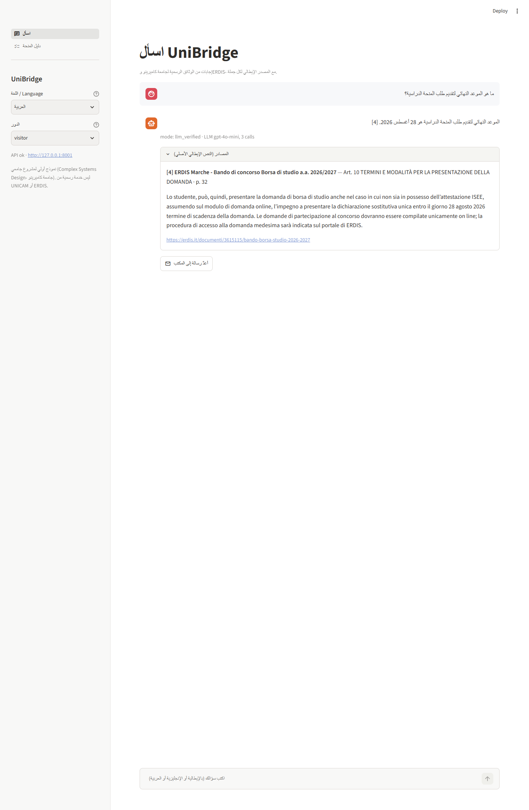

# UniBridge - multilingual assistant for international students

**Complex Systems Design** - MSc in Computer Science (AI), University of Camerino - Prof. Flavio Corradini.
Author: Ahmad Kassar. Branch `unibridge`; built on the P14 search engine documented further below.

International students in Camerino must follow rules written in Italian: the student guide and regulations of the
University of Camerino, the ERDIS Marche call for the regional scholarship, the ministry circular on foreign
students. UniBridge lets them ask in **17 languages** (Italian, English, Arabic, French, Spanish, Portuguese, German,
Romanian, Albanian, Ukrainian, Russian, Turkish, Persian, Urdu, Hindi, Bengali, Chinese). It finds the exact passage
in the official Italian documents and answers in the language of the question, with a **citation for every sentence
and the Italian original next to it**. When the documents are not enough it says **"I don't know"** and drafts a
formal Italian e-mail to the right office (never sent automatically). For the ERDIS scholarship it offers a **guide**
driven by a BPMN model of the call, verified as a **sound Petri net**, with eligibility checked by fixed rules.

| | |
|---|---|
| **Deliverables** | [Technical report (PDF)](deliverables/UniBridge_Technical_Report_Ahmad_Kassar.pdf) · [Word](deliverables/UniBridge_Technical_Report_Ahmad_Kassar.docx) · [Presentation (PowerPoint)](deliverables/UniBridge_Presentation_Ahmad_Kassar.pptx) · [PDF](deliverables/UniBridge_Presentation_Ahmad_Kassar.pdf) |
| **Report (Markdown)** | [docs/REPORT_UNIBRIDGE.md](docs/REPORT_UNIBRIDGE.md) · data [DATA_UNIBRIDGE.md](docs/DATA_UNIBRIDGE.md) · procedure [PROCEDURE.md](docs/PROCEDURE.md) · [open questions](docs/OPEN_QUESTIONS.md) |
| **Corpus** | 42 official public documents (ERDIS Marche, UNICAM, MUR, Normattiva) + 6 synthetic restricted notes (labelled), 2,330 passages |
| **Test sets** | 102 frozen questions (42 Italian from official FAQ pages, 30 English, 30 Arabic) + 616 frozen questions in 14 more languages |
| **Keyword search vs Arabic** | BM25 finds no relevant passage for 100% of the Arabic test questions |
| **Translate and fuse** | nDCG@10 0.41 → 0.51 on the 102 questions (p = 0.0012); 0.36 → 0.48 in the 14 added languages |
| **Answers** | Citation precision 0.41 extractive, 0.78 with the LLM, 0.78 with LLM + verifier; all out-of-scope questions get "I don't know" |
| **Languages** | Question language detected correctly in 99.8% of cases; 99.5% of the answers are in the language of the question (14 added languages) |
| **Procedure** | Workflow net sound (own state-space check + pm4py WOFLAN); 15 of 15 test scenarios correct |
| **Cost** | gpt-4o-mini, 0.000316 USD per verified answer; whole project 0.40 USD |
| **Tests** | `pytest`: 126 passed in 8.44s |



### Features
- **Ask** (`POST /v1/answer`): language detection, hybrid search (BM25 + multilingual embeddings), translation of the
  question into Italian and rank fusion, an answer from the retrieved passages only, a verifier that drops sentences
  without a valid or supporting citation, and the Italian original of every cited passage. Without an LLM key the
  answer is extractive (Italian sentences copied from the documents).
- **"I don't know" + office e-mail** (`POST /v1/handoff`): rule table for the scholarship, student or international
  office; formal Italian draft with the question translated and the documents already checked.
- **Scholarship guide** (`POST /v1/procedure/scholarship`): fixed eligibility rules (credits, ISEE, ISPE, year,
  deadlines), each with its article; position in the procedure; personal checklist; `.ics` calendar. No LLM; the
  data is not stored.
- **Roles**: visitor (public documents), student (+ student-only notices), office staff (+ their internal notes).
  Permissions are applied inside retrieval.

### Quick start (Windows, PowerShell)
Requirements: Python 3.11, Docker Desktop, about 2 GB of disk for models and corpus; an NVIDIA GPU is optional
(`EMBEDDING_DEVICE=cpu` in `.env` without it). Free ports: 6333 (Qdrant), 8001 (API), 8501 (demo).

```powershell
# 1. Python environment and dependencies
python -m pip install --user uv
python -m uv python install 3.11
python -m uv venv --python 3.11 .venv
python -m uv pip install --python .venv\Scripts\python.exe -e ".[dev,data,ui]"

# 2. Configuration (demo keys; optional LLM)
copy .env.example .env
# optional, for LLM answers: in .env set LLM_PROVIDER=openai (or anthropic), LLM_MODEL=gpt-4o-mini, LLM_API_KEY=...
# without them UniBridge works with extractive answers and makes no API call

# 3. Vector database
docker compose up -d

# 4. Corpus and index (first time only)
.venv\Scripts\python.exe scripts\fetch_corpus_unibridge.py   # downloads the official documents, checks SHA-256
.venv\Scripts\python.exe scripts\ingest_unibridge.py         # own SQLite file + Qdrant collection

# 5. Start the API (keep this window open)
.venv\Scripts\python.exe -m uvicorn p14_search.unibridge_main:app --port 8001

# 6. In a second window: the demo
.venv\Scripts\streamlit.exe run frontend\unibridge_app.py
```
Open http://localhost:8501 (demo) and http://127.0.0.1:8001/docs (API documentation). The demo starts in the
language of the browser; the answer always follows the language of the question.

### Calling the API
Every request carries an `X-API-Key` header; the demo keys of the roles are in `.env.example`
(`demo-ub-visitor`, `demo-ub-student`, `demo-ub-scholarship-office`, ...).

```powershell
# Ask a question (any of the 17 languages)
curl.exe -s -X POST http://127.0.0.1:8001/v1/answer -H "X-API-Key: demo-ub-visitor" -H "Content-Type: application/json" -d "{\"query\": \"When is the deadline for the scholarship application?\"}"

# Draft an e-mail to the right office
curl.exe -s -X POST http://127.0.0.1:8001/v1/handoff -H "X-API-Key: demo-ub-visitor" -H "Content-Type: application/json" -d "{\"query\": \"Can I get a refund of the university fees?\", \"language\": \"en\"}"

# Scholarship guide: second-year bachelor student, ISEE 15,000 EUR, on 1 August 2026
curl.exe -s -X POST http://127.0.0.1:8001/v1/procedure/scholarship -H "X-API-Key: demo-ub-visitor" -H "Content-Type: application/json" -d "{\"language\": \"en\", \"today\": \"2026-08-01\", \"level\": \"L\", \"year\": 2, \"credits\": 30, \"isee\": 15000, \"residence\": \"fuori_sede\"}"
```
Contracts: `contracts/openapi/p14-search.yaml` and `contracts/schemas/` (AnswerRequest, AnswerResponse,
HandoffRequest, ProcedureRequest, ...).

### Tests and evaluation
```powershell
.venv\Scripts\python.exe -m pytest                                   # unit and API tests, fake LLM only

# evaluations on the frozen test splits (results in eval\results\unibridge\)
.venv\Scripts\python.exe eval\freeze_test.py --dataset unibridge --verify
.venv\Scripts\python.exe eval\unibridge\run_eval.py                  # retrieval B0 / S1 / S2 by language
.venv\Scripts\python.exe eval\unibridge\eval_translation.py          # S3: translate the question before retrieval (LLM)
.venv\Scripts\python.exe eval\unibridge\eval_answers.py              # extractive vs LLM vs LLM + verifier (LLM)
.venv\Scripts\python.exe eval\unibridge\eval_multilingual.py         # 17 languages (LLM)
.venv\Scripts\python.exe eval\unibridge\eval_procedure.py            # 15 scholarship scenarios
.venv\Scripts\python.exe eval\unibridge\eval_handoff.py              # office routing
.venv\Scripts\python.exe scripts\build_scholarship_model.py          # BPMN + PNML + soundness check
.venv\Scripts\python.exe eval\check_doc_numbers.py                   # every number in the reports vs eval\results
```
LLM steps use temperature 0 and a disk cache, so a re-run gives the same answers at no cost; every call is logged
in `logs\llm_usage.jsonl` and stops at 5 USD of estimated spend.

### Rebuilding the deliverables
```powershell
.venv\Scripts\python.exe scripts\render_mermaid.py                   # diagrams -> docs\images\ub-*.png
.venv\Scripts\python.exe scripts\render_bpmn.py                      # BPMN picture -> docs\images\scholarship_bpmn.png
.venv\Scripts\python.exe scripts\build_report_docx.py                # report .docx + .pdf (needs Microsoft Word)
cd deliverables\build; npm install; node build_presentation.js; cd ..\..    # presentation .pptx (export the PDF from PowerPoint)
.venv\Scripts\python.exe scripts\capture_evidence_unibridge.py       # screenshots (API and demo running; needs the 'evidence' extra)
```

### Where things are
| Path | What |
|---|---|
| `src/p14_search/answer/` | language, translation, LLM answer, verifier, extractive fallback, LLM providers with cache and budget |
| `src/p14_search/i18n.py`, `i18n_llm.json` | the 17 languages and the fixed texts (hand-written it/en/ar; LLM-translated for the others) |
| `src/p14_search/handoff/` | office rule table and Italian e-mail draft |
| `src/p14_search/procedure/` | procedure model, rules, state machine, checklist, `.ics` |
| `src/p14_search/unibridge_profile.py`, `unibridge_main.py` | UniBridge configuration and API entry point |
| `frontend/unibridge_app.py`, `frontend/unibridge_pages/` | Streamlit demo |
| `docs/bpmn/` | `scholarship.bpmn` (BPMN 2.0) and `scholarship.pnml` (workflow net) |
| `eval/unibridge/`, `eval/queries/`, `eval/qrels/` | evaluation scripts, question sets, relevance judgments |
| `eval/results/unibridge/` | every result quoted in the documents |
| `eval/review/` | LLM-produced items to be checked by a person |
| `docs/evidence/unibridge/` | screenshots and a recorded API session |
| `deliverables/` | report and presentation; `deliverables/build/` rebuilds the presentation |

**Use of AI tools.** An AI coding assistant (Claude Code) was used for code, documentation and the synthetic
documents; an LLM (gpt-4o-mini) produced the translated questions, paraphrases, query translations, the interface
texts of 14 languages and the answers under evaluation. All LLM-produced data is flagged `llm_generated: true`;
details in section 11 of the report. Translations and LLM-drafted items still need review by native speakers
(`eval/review/`).

---

# P14 - Intelligent Search Across Organizational Knowledge

**Complex Systems Design** - MSc in Computer Science (AI curriculum), University of Camerino - Prof. Flavio Corradini
AI Puzzle framework, consolidated version 5.0, piece **P14**. Author: Ahmad Kassar.

A local search service for the documents of an organization. It finds information **by meaning** (multilingual
embeddings) and **by keyword** (BM25), fuses the two rankings, shows each user **only what they are allowed to see**,
and returns the **exact source** of every passage: document, version, section, page and character offsets. When the
evidence is weak it says so (`insufficient_evidence`) instead of guessing.

The case study is a fictional Italian public body, **Ente Demo**: 32 real Italian official acts (Normattiva,
Gazzetta Ufficiale) plus 25 **synthetic** internal documents, labelled as such in every file.

## Deliverables
| What | File |
|---|---|
| Technical report (17 pages) | [deliverables/P14_Technical_Report_Ahmad_Kassar.pdf](deliverables/P14_Technical_Report_Ahmad_Kassar.pdf) |
| Presentation (16 slides, with speaker notes) | [PowerPoint](deliverables/P14_Presentation_Ahmad_Kassar.pptx) · [PDF](deliverables/P14_Presentation_Ahmad_Kassar.pdf) |
| Report in Markdown | [docs/REPORT.md](docs/REPORT.md) |
| The 8 common deliverables of the AI Puzzle, mapped to files | [docs/DELIVERABLES_CHECKLIST.md](docs/DELIVERABLES_CHECKLIST.md) |

## At a glance
| | |
|---|---|
| **Problem** | Users ask with everyday words, documents use legal language: keyword search misses the answer |
| **Solution** | Hybrid search (BM25 + multilingual embeddings), permission filter inside retrieval, citations on every passage |
| **Main result** | nDCG@10 **0.60** for hybrid vs **0.45** for keyword search (p = 0.0001) on a test set frozen before tuning |
| **Biggest win** | Paraphrased questions: **0.47** (semantic) vs **0.16** (keyword) |
| **Safety** | **0** permission leaks in 18,576 checks; median response time about 47 ms |
| **Honest miss** | Own target "correct source in top 3 ≥ 80%" not met: **76.7%** |


### Where P14 sits in the AI Puzzle
The course framework describes 26 AI projects that are useful on their own and can be connected in a final
composition phase. P14 is a hub: **P11, P15 and P25** can send it documents to index, and **P24, P12, P15 and P25**
can use its search. In this repository **P24 and P12 are implemented as working mock consumers**; the other
connections are documented in [docs/INTEGRATION.md](docs/INTEGRATION.md).


---

## Contents
1. [Features](#1-features)
2. [Architecture](#2-architecture)
3. [Requirements](#3-requirements)
4. [Installation](#4-installation)
5. [Starting the system](#5-starting-the-system)
6. [Using it](#6-using-it)
7. [Tests and evaluation](#7-tests-and-evaluation)
8. [Results](#8-results)
9. [Repository structure](#9-repository-structure)
10. [Documentation](#10-documentation)
11. [Limitations](#11-limitations)
12. [Data, licences and use of AI tools](#12-data-licences-and-use-of-ai-tools)
13. [Troubleshooting](#13-troubleshooting)

---

## 1. Features
- **Hybrid retrieval**: BM25 (SQLite FTS5) and dense retrieval (`intfloat/multilingual-e5-small` in Qdrant),
  merged with Reciprocal Rank Fusion (k = 60). Italian and English queries.
- **Citations on every passage**: document id, content-hash version, section, page, character offsets; any cited
  passage can be fetched again by its id, also from superseded versions.
- **Access control inside retrieval**: three levels (public, internal, restricted by office) applied inside both
  retrievers, re-checked on output. Invisible documents return 404.
- **Human approval before indexing**: an uploaded document stays pending until its owner approves it.
- **Evidence check**: a calibrated threshold flags weak results as `insufficient_evidence`.
- **Extractive summary**: sentences copied from the sources, each with its passage id; nothing is generated.
- **Traceability**: a version block in every response; every query logged with a pseudonymised user; feedback stored.
- **Shadow mode**: a second system runs on the same query and is logged, without being shown.
- **Integration contract**: frozen OpenAPI + JSON Schemas, real input/output examples, two mock consumers (P24, P12).
- **Safe parsing** of PDF, DOCX, HTML and TXT (type check, size limit, macros, XXE, zip bombs, encrypted PDFs).

## 2. Architecture
One FastAPI service, one Qdrant container, one SQLite file. No paid services, everything runs locally.

```
 Documents   Streamlit demo   P24 mock   P12 mock
     \             |             |          /
      v            v             v         v
   +------------------------------------------+
   |   REST API /v1  (FastAPI, API key auth)   |
   |  Ingestion pipeline  |  Search pipeline   |
   |  parse, chunk,       |  ACL filter, BM25 +|
   |  owner approval      |  dense, RRF, cite  |
   +------------------------------------------+
          |                         |
   Qdrant (vectors +          SQLite (documents, passages,
   access-level payload)      FTS5 BM25 index, logs)
```
Details: [docs/ARCHITECTURE.md](docs/ARCHITECTURE.md); diagrams (Mermaid) in [docs/diagrams/](docs/diagrams/);
design decisions in [docs/DECISIONS.md](docs/DECISIONS.md) (ADR-001 to ADR-009).

**How a search works** (permission filter inside both retrievers, fusion, citations, evidence check, logging):


<details>
<summary>More diagrams: components, ingestion with owner approval, classes, integration</summary>


</details>

## 3. Requirements
| What | Version / note |
|---|---|
| OS | Windows 11 (tested); Linux and macOS should work with the equivalent commands |
| Python | 3.11 (exactly: `>=3.11,<3.12`) |
| Docker | Docker Desktop, for Qdrant |
| GPU | Optional. NVIDIA GPU with CUDA 12.8 recommended; without it set `EMBEDDING_DEVICE=cpu` (slower) |
| Disk / network | About 35 MB of documents plus the embedding models from Hugging Face, downloaded once |
| Free ports | 8000 (API), 6333-6334 (Qdrant), 8501 (Streamlit) |

## 4. Installation
From the repository root, in PowerShell:

```powershell
# 1. Python environment (uv installs Python 3.11 if missing)
python -m pip install --user uv
python -m uv python install 3.11
python -m uv venv --python 3.11 .venv
python -m uv pip install --python .venv\Scripts\python.exe -e ".[dev,data,ui]"

# 2. Configuration: demo API keys and calibrated thresholds
copy .env.example .env

# 3. Vector database
docker compose up -d
```
Without uv: create a Python 3.11 virtual environment, run
`pip install torch --index-url https://download.pytorch.org/whl/cu128`, then `pip install -e ".[dev,data,ui]"`.
Without an NVIDIA GPU: in `.env` set `EMBEDDING_DEVICE=cpu`.

**Build the corpus and the index** (first time only, a few minutes):
```powershell
.venv\Scripts\python.exe scripts\fetch_corpus.py      # downloads the real acts (D1a) and SciFact (D2)
.venv\Scripts\python.exe scripts\generate_d1b.py      # renders the synthetic internal documents (D1b)
.venv\Scripts\python.exe scripts\ingest_corpus.py     # parses, chunks, approves (simulated) and indexes everything
```

## 5. Starting the system
Every time, in this order:

```powershell
# 1. Start Docker Desktop, then Qdrant (if it is not already running)
docker compose up -d

# 2. Start the API (leave this window open)
.venv\Scripts\python.exe -m uvicorn p14_search.main:app --port 8000

# 3. In a second PowerShell window: start the demo interface
.venv\Scripts\streamlit.exe run frontend\app.py
```
- API documentation (Swagger): http://127.0.0.1:8000/docs
- Health check: http://127.0.0.1:8000/v1/health (should report `sqlite` and `qdrant` as `ok`)
- Demo: http://localhost:8501

To stop: `Ctrl+C` in the API and demo windows, then `docker compose stop`.

## 6. Using it
**Demo.** Choose the user ("principal") in the sidebar, type a question, read the ranked passages with their
citations. Ask *"budget formazione 2026"* as `employee`, then as `hr-officer`: the restricted budget appears only
for HR. As `p24-external-assistant` only public content is visible.

| Answer with its source | Same question, HR officer sees the restricted budget | Out-of-scope question: no guessing |
|---|---|---|
|  |  |  |

**API.** Every request carries an `X-API-Key` header. Demo keys (from `.env.example`):

| Principal | Key | Sees |
|---|---|---|
| p24-external-assistant | demo-p24-public | public |
| p12-document-generation, employee | demo-p12-generation, demo-employee | public + internal |
| hr-officer, it-officer, legal-officer, dpo, rspp | demo-hr-officer, demo-it-officer, demo-legal-officer, demo-dpo, demo-rspp | + restricted documents of their office |
| admin | demo-admin | everything |

```powershell
curl.exe -s -X POST http://127.0.0.1:8000/v1/search -H "X-API-Key: demo-employee" -H "Content-Type: application/json" -d "{\"query\": \"Quanti giorni al mese posso lavorare da casa?\"}"
```

| Endpoint | Purpose |
|---|---|
| POST /v1/search | Ranked documents and passages, citations, evidence, optional summary, versions |
| POST /v1/documents | Upload an `IngestDocument` (stays pending) |
| POST /v1/documents/{id}/approve | Owner approval: the document becomes searchable |
| GET /v1/documents/{id} | Metadata, status, versions |
| GET /v1/passages/{id} | Resolve a cited passage |
| POST /v1/feedback | Store the user's judgement on a passage |
| GET /v1/health, GET /v1/version | Status and version block |

**Mock consumers** (other puzzle pieces using P14, with the API running):
```powershell
.venv\Scripts\python.exe mocks\p24_external_assistant\p24_client.py "Quanto costano le copie per l'accesso agli atti?"
.venv\Scripts\python.exe mocks\p12_document_generation\p12_client.py "lavoro agile disconnessione"
```
Contract, schemas and real examples: [contracts/](contracts/) and [docs/INTEGRATION.md](docs/INTEGRATION.md).

## 7. Tests and evaluation
```powershell
.venv\Scripts\python.exe -m pytest                      # unit, API, ACL leakage, contract, mocks, UI (no Docker needed)
.venv\Scripts\python.exe scripts\reproduce.py --clean   # rebuilds index, evaluation and result tables (about 7.5 min on GPU)
```
`reproduce.py` runs 13 steps: corpus, ingestion, judgments, check of the frozen test split, model comparison,
threshold calibration, tests, evaluation, error analysis and rendering of the result tables into the docs.
Every number in the documentation comes from a file in `eval/results/`; `eval/check_doc_numbers.py` verifies it.
Full procedure: [docs/REPRODUCIBILITY.md](docs/REPRODUCIBILITY.md).

## 8. Results
Held-out test split: 60 answerable and 10 out-of-scope queries. B0 = BM25 baseline, S1 = dense, S2 = hybrid.

| Metric | B0 BM25 | S1 dense | S2 hybrid |
|---|---|---|---|
| nDCG@10 | 0.453 | 0.603 | 0.604 |
| Recall@10 | 0.557 | 0.722 | 0.760 |
| Correct source in top 3 | 0.583 | 0.733 | 0.767 |
| Latency p95 (in-process API) | 15.5 ms | 91.1 ms | 77.0 ms |

- S2 vs B0: +0.15 nDCG@10, paired randomization test p = 0.0001. S2 vs S1: not significant (p = 0.97).
- 0 access-control leaks over 18,576 checked passages (9 users x 70 queries x 3 systems).
- Own target "correct source in top 3 >= 80%" **not met** (76.7%); causes in the error analysis.
- SciFact sanity check: nDCG@10 0.631 (B0), 0.659 (S1), 0.686 (S2).


Full tables, statistics and error analysis: [docs/EVALUATION.md](docs/EVALUATION.md).

## 9. Repository structure
```
src/p14_search/          application code
  api/                   FastAPI app, endpoints, errors (RFC 9457)
  ingestion/             safe parser, chunker, ingestion and approval service
  indexing/              SQLite + FTS5 store, Qdrant index, embedder
  retrieval/             BM25 / dense retrievers, RRF, citations, evidence, summary, logging
  security/              principals (API keys) and access-control filters
  evaluation/            metrics and evaluation runner
  observability/         structured JSON logging
deliverables/            technical report (PDF) and presentation (PPTX, PDF)
frontend/app.py          Streamlit demo
mocks/                   P24 and P12 mock consumers
contracts/               OpenAPI, JSON Schemas, real examples
config/principals.json   users, levels, offices (no secrets)
scripts/                 corpus download, synthetic documents, ingestion, reproduction
eval/                    question set, judgments, evaluation scripts, results
data/                    D1a manifest, D1b sources (raw and processed data are generated, not committed)
docs/                    report and technical documentation
tests/                   pytest suites
```

## 10. Documentation
| File | Content |
|---|---|
| [docs/REPORT.md](docs/REPORT.md) | Technical report (start here) |
| [docs/COURSE_REQUIREMENTS.md](docs/COURSE_REQUIREMENTS.md) | Requirements taken from the course document |
| [docs/DELIVERABLES_CHECKLIST.md](docs/DELIVERABLES_CHECKLIST.md) | The 8 common deliverables and where they are |
| [docs/PROJECT_PROPOSAL.md](docs/PROJECT_PROPOSAL.md) | Project sheet in the 7-section template, MVP vs stretch goals |
| [docs/ARCHITECTURE.md](docs/ARCHITECTURE.md), [docs/diagrams/](docs/diagrams/) | Architecture, access model, identifiers, diagrams |
| [docs/DECISIONS.md](docs/DECISIONS.md) | Architectural decision records ADR-001 to ADR-009 |
| [docs/DATA.md](docs/DATA.md) | Sources, licences, schema, statistics, quality, privacy |
| [docs/ANNOTATION_PROTOCOL.md](docs/ANNOTATION_PROTOCOL.md) | How the queries and relevance judgments were made |
| [docs/EVALUATION.md](docs/EVALUATION.md) | Method, results, targets, error analysis |
| [docs/INTEGRATION.md](docs/INTEGRATION.md) | API contract and connections with other pieces |
| [docs/SECURITY_OVERSIGHT.md](docs/SECURITY_OVERSIGHT.md) | Security, traceability, human oversight, shadow mode |
| [docs/REPRODUCIBILITY.md](docs/REPRODUCIBILITY.md) | From a clean clone to the results |
| [docs/OPEN_QUESTIONS.md](docs/OPEN_QUESTIONS.md) | Points that require the professor's confirmation |
| [docs/evidence/](docs/evidence/) | Screenshots and logs of a real local run |

## 11. Limitations
- No real organization: internal documents are synthetic; access levels of public laws are assigned by us.
- Queries and relevance judgments were drafted with an LLM and are incomplete; small test set (60 + 10 queries).
- Not measured: human rating of source quality, real time-to-information, a shadow phase with real users.
- Not implemented: cross-encoder reranker, `/related` endpoint, identity provider, tombstones for deleted documents.

## 12. Data, licences and use of AI tools
- **D1a**: Italian official acts, excluded from copyright by art. 5 L. 633/1941; source URL and hash recorded per file.
- **D1b**: synthetic documents created for this project; every file carries the banner "DOCUMENTO SINTETICO".
- **D2**: BEIR SciFact, CC BY 4.0 / ODC-By 1.0.
- **AI tools**: an AI coding assistant was used during development (code, documentation, synthetic documents,
  drafting of the evaluation queries). Synthetic and LLM-drafted data are flagged (`synthetic`, `llm_generated`).
  Details in the technical report.

## 13. Troubleshooting
| Problem | Fix |
|---|---|
| `/v1/health` reports qdrant `degraded`, or 503 on search | Start Docker Desktop, then `docker compose up -d` |
| 401 Unauthorized | Missing or wrong `X-API-Key`; check that `.env` exists (copy `.env.example`) |
| Search returns nothing | The index is empty: run `scripts\ingest_corpus.py` |
| CUDA / torch error | Set `EMBEDDING_DEVICE=cpu` in `.env` |
| Port already in use | Change `--port` for the API, or stop the other program |
