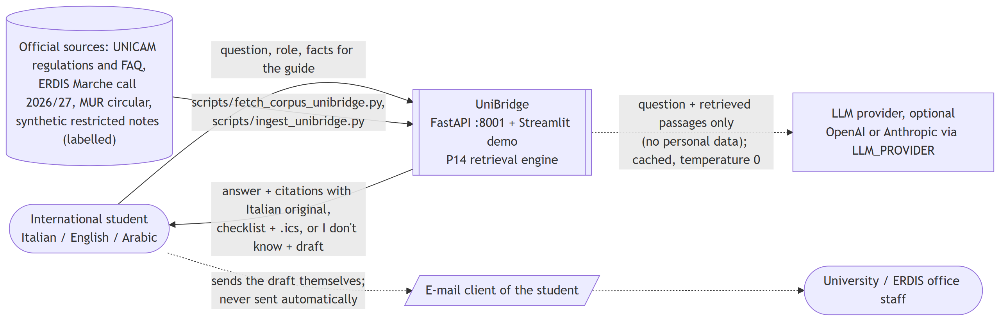
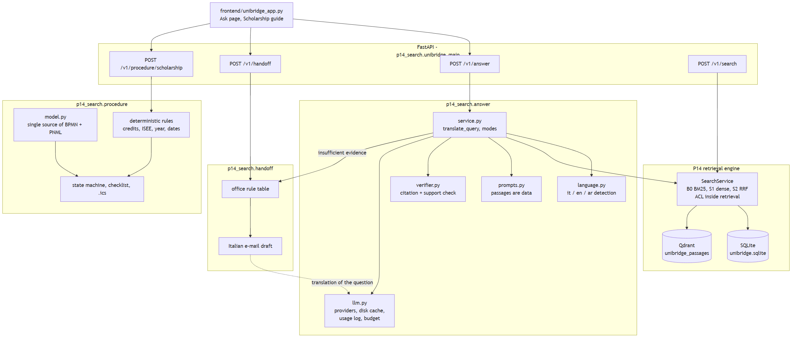
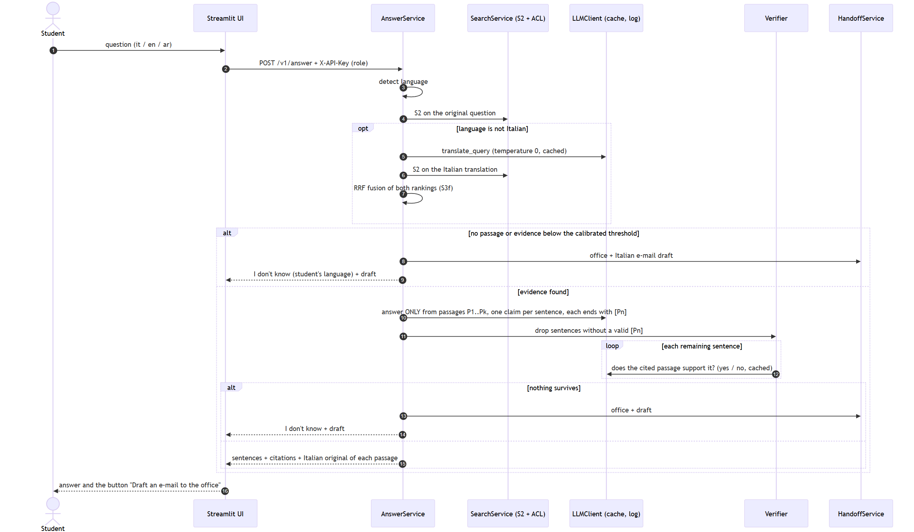
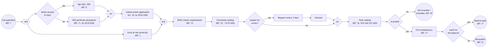

# UniBridge - a multilingual assistant for international students
### Technical report - Complex Systems Design, MSc Computer Science (AI), University of Camerino

Author: Ahmad Kassar. Course: Complex Systems Design (Prof. Flavio Corradini). Branch `unibridge` of this repository.
UniBridge is built on the P14 search engine of the same repository (hybrid retrieval, ACL, citations,
evaluation harness): see [REPORT.md](REPORT.md) for P14 itself.

Every number in this report is produced by a committed script and read from a file in `eval/results/unibridge/`;
`python eval/check_doc_numbers.py` checks the decimals of this file against those files.

## 1. Problem

International students in Camerino must follow Italian rules written in Italian: the university's student
guide and regulations, the ERDIS Marche scholarship call (about 70 pages), the ministerial circular on the
admission of foreign students. Many of them read English or Arabic better than Italian. A wrong reading has a
cost: a missed deadline excludes the student from the scholarship (Art. 10 of the call), a missing ISEE
parificato document makes the application incomplete.

General-purpose chatbots answer fluently but do not show where an answer comes from, and they invent dates.
UniBridge answers **only from official documents**, shows **the Italian sentence behind each claim**, says
**"I don't know"** when the evidence is weak, and then helps the student write to the right office.

## 2. Users and roles

| Role | Who | Sees (P14 access level) |
|---|---|---|
| visitor | prospective student, anyone | public documents (`public`) |
| student | enrolled student | + student-only notices (`internal`) |
| scholarship / student / international office | office staff | + that office's internal notes (`restricted`, own office) |
| unibridge-admin | maintainer | everything |

Roles are mapped onto the P14 access levels (config/principals_unibridge.json): no new ACL code. Student-only
notices and internal office notes are **synthetic** (6 documents, labelled `[SINTETICO]` in the title and
text), because real ones are not public.

## 3. Architecture

UniBridge is a **profile** of the P14 service (`src/p14_search/unibridge_profile.py`): same code, its own SQLite
file, Qdrant collection and principals. New modules:

| Module | Role |
|---|---|
| `answer/` | language detection, query translation, LLM answer with citations, verifier, extractive fallback |
| `answer/llm.py` | OpenAI / Anthropic behind one interface (`LLM_PROVIDER`), fake provider for tests, disk cache, usage log, spend limit |
| `handoff/` | office routing rule table, Italian e-mail draft (never sent) |
| `procedure/` | scholarship procedure model, deterministic eligibility rules, state machine, checklist, `.ics` |
| `frontend/unibridge_app.py` | Streamlit demo: Ask page, Scholarship guide |

Endpoints: `POST /v1/answer`, `POST /v1/handoff`, `POST /v1/procedure/scholarship`, plus the P14 endpoints.

### 3.1 Answer pipeline

1. Detect the language of the question (it / en / ar).
2. Retrieve with S2 (BM25 + multilingual-e5-small, RRF), ACL applied inside retrieval.
3. If the question is not Italian and an LLM is configured: translate it into Italian (temperature 0,
   cached) and fuse the two rankings with RRF (system **S3f**, see the S3 experiment below).
4. If no passage passes the calibrated evidence threshold: "I don't know" in the student's language + handoff.
5. Otherwise the LLM answers **only from the numbered passages**, in the student's language, one claim per
   sentence, each sentence ending with `[Pn]`. Passages are wrapped as data; the prompt says they are never
   instructions (prompt-injection guard).
6. Verifier: drop sentences without a valid passage id; then the same LLM is asked, per sentence, whether the
   cited passage supports it (yes/no, cached). If nothing survives: "I don't know" + handoff.
7. The response carries every sentence with its passage, and the Italian original of every cited passage.

Without an API key (or when the call fails or the budget is reached) the answer is **extractive**: Italian
sentences copied from the passages, each with its citation.

## 4. Data

Details: [DATA_UNIBRIDGE.md](DATA_UNIBRIDGE.md). 42 real public documents (ERDIS Marche, UNICAM, UNICAM
International, MUR, Normattiva) and 6 synthetic restricted ones: 2,330 passages. Raw files are not committed;
`scripts/fetch_corpus_unibridge.py` re-downloads them and checks the SHA-256 recorded in the manifest.
Licences are recorded per document; unicam.it pages have no open licence and are used locally only
(OPEN_QUESTIONS U3).

**Question set** (`eval/queries/unibridge_queries.jsonl`): 155 questions, 102 in the frozen test split
(42 Italian, 30 English, 30 Arabic; 9 out of scope). Italian questions are **real questions from official FAQ
pages** (ERDIS, UNICAM International), with the FAQ answer as ground truth; English and Arabic versions and
everyday paraphrases were produced by an LLM and are flagged `llm_generated: true` (Arabic and English also
`needs_native_review: true`). The test split was frozen with a SHA-256 before any tuning
(`eval/freeze_test.py --dataset unibridge`).

## 5. Procedure model (Complex Systems Design core)

The ERDIS scholarship procedure 2026/2027 is defined once in `src/p14_search/procedure/model.py`; the BPMN 2.0
file `docs/bpmn/scholarship.bpmn` (24 nodes, 26 flows) and the workflow net `docs/bpmn/scholarship.pnml`
(18 places, 20 transitions, 42 arcs) are generated from it, so they cannot disagree. Every step and deadline is
tied to an article of the call ([PROCEDURE.md](PROCEDURE.md)).

**Soundness** (`eval/results/unibridge/procedure_soundness.json`): the net is a workflow net (single source
`i`, single sink `o`, every node on a path from `i` to `o`); the reachability graph has 19 markings; the net
is bounded, has the option to complete, proper completion and no dead transitions, so it is **sound**. The
check is done twice: by our own reachability analysis and by pm4py's WOFLAN on the PNML file (both: sound).
Verification in WoPeD is described in PROCEDURE.md (screenshot to be taken by hand).

**Guide**: the state machine replays the net on the student's facts; eligibility rules (credits by year,
ISEE and ISPE limits of Art. 8, prior degree, duration, residence permit, deadlines) are
**deterministic code**, each with the article that defines it; no LLM is involved and the facts are not stored.
On 15 fictional scenarios with the expected checklist written from the call, 15 are fully correct
(verdict, rules, checklist, marking, next steps; `procedure_eval.json`, accuracy 1.0). The scenarios were written
by the same author as the rules, so this tests consistency with our reading of the call, not the reading itself.

## 6. Evaluation

All on the frozen test split (102 questions), role visitor, calibration of the evidence thresholds on the tuning
split only (`calibration.json`).

### 6.1 Retrieval: B0, S1, S2 (`eval_latest.json`)

| nDCG@10 | B0 BM25 | S1 dense | S2 hybrid |
|---|---|---|---|
| all (93 in scope) | 0.3218 | 0.4101 | 0.4123 |
| Italian (39) | 0.4869 | 0.5469 | 0.5532 |
| English (28) | 0.3907 | 0.3898 | 0.3966 |
| Arabic (26) | 0.0 | 0.227 | 0.2179 |

**Hypothesis tested: "BM25 fails on Arabic questions over Italian text" - confirmed.** For 100% of the Arabic
in-scope test questions BM25 returns no relevant passage in the top 10, and for 92.31% it returns nothing at all
(no shared terms). The dense model recovers part of it (nDCG@10 0.227), still far below Italian. S2 vs B0 on
Arabic: p = 0.0017; S2 vs S1: no significant difference in any language (p = 0.9021 overall).
ACL: 0 leaks in 16,626 checked passages (6 roles x 102 questions x 3 systems).

### 6.2 Experiment S3: translate the question into Italian before retrieval (`translation_latest.json`)

Systems: S3 = S2 run on the LLM Italian translation (Italian questions unchanged, so S3 = S2 on them); S3f =
RRF of S2(original) and S2(translation), which is what the answer service does. No tuning on the test split:
the translation prompt was fixed in phase 4, temperature 0, cache on; thresholds are the S2 calibration.
60 translations, estimated cost 0.001041 USD.

| | S1 dense | S2 hybrid | S3 translated | S3f fused |
|---|---|---|---|---|
| nDCG@10 English | 0.3898 | 0.3966 | 0.3148 | 0.5187 |
| nDCG@10 Arabic | 0.227 | 0.2179 | 0.4324 | 0.4295 |
| recall@10 English | 0.3869 | 0.4137 | 0.4301 | 0.7277 |
| recall@10 Arabic | 0.25 | 0.2452 | 0.5256 | 0.6314 |
| correct source in top 3, Arabic | 0.2692 | 0.2308 | 0.6923 | 0.7308 |
| false "insufficient evidence", Arabic | 0.6538 | 0.6538 | 0.0769 | 0.0385 |
| nDCG@10 all 102 | 0.4101 | 0.4123 | 0.4476 | 0.5082 |

Findings:
- **Arabic**: translation roughly doubles nDCG@10 (0.2179 -> 0.4324) and cuts false "insufficient evidence" from
  65.38% to 7.69% of the Arabic questions. Paired randomization test S3 vs S2 on Arabic nDCG@10: p = 0.0954 (n = 26, not significant
  at 0.05); S3f vs S2: p = 0.006.
- **English**: S3 alone *loses* nDCG@10 (0.3966 -> 0.3148, p = 0.5476) while S3f gains (0.5187). A likely cause,
  measured but not confirmed by human judgement: the corpus contains English versions of the call and of the
  teaching regulation. For English questions, S2 takes 52 of its 84 top-3 passages from those English documents,
  but only 6 of the 60 grade-2 passages in the qrels are in them (the ground truth comes from Italian FAQs).
  Translating to Italian moves retrieval away from the English documents. The qrels may under-rate the
  English versions.
- **Fusion is the robust choice**: S3f vs S2 on all questions nDCG@10 p = 0.0012 and recall@10 p = 0.0001; it
  keeps what the original-language ranking finds and adds what the translation finds.
- Cost of the fused design: on out-of-scope questions abstention drops from 1.0 to 0.8889 (one of 9 out-of-scope
  questions is no longer flagged); the answer step can still say "I don't know".
- **Bias to keep in mind**: English and Arabic test questions are LLM translations of Italian FAQs, and S3
  translates them back with an LLM. The round trip may reconstruct the original Italian wording better than a
  real student's question would. Native-written questions are needed to confirm the gain.

### 6.3 Answers: extractive vs LLM vs LLM + verifier

Source: `eval/results/unibridge/answers_20261111-172151.json` (copy: `answers_latest.json`). Same retrieval for all
three (S2; LLM configurations add the translation fusion S3f). Model: OpenAI gpt-4o-mini, temperature 0.
Each configuration has its own response cache, so costs and latencies are those of a cold first run.

| 102 test questions | extractive | LLM, no verifier | LLM + verifier |
|---|---|---|---|
| answered (not "I don't know") | 69 | 87 | 85 |
| citation precision (cited passage is relevant) | 0.4058 | 0.801 | 0.8157 |
| sentences without a valid citation | 0.0 | 0.0661 | 0.0 |
| sentences the support check rejects (*) | 0.029 | 0.0891 | 0.0 |
| answer in the question's language | 0.9275 | 0.9885 | 0.9882 |
| "I don't know" on out-of-scope (9) | 1.0 | 1.0 | 1.0 |
| "I don't know" on in-scope (should be low) | 0.2581 | 0.0645 | 0.086 |
| relevant passages given to the answer step | 0.4265 | 0.6089 | 0.6089 |
| LLM calls per answer | 0.0 | 1.5 | 3.51 |
| estimated cost per answer (USD) | 0.0 | 0.000233 | 0.000313 |
| latency p50 / p95 (ms) | 27.6 / 35.6 | 2294.5 / 3531.9 | 2982.9 / 7241.6 |

(*) The support check is the verifier's own yes/no call (same model, same prompt): for "LLM, no verifier" it
measures what the verifier would remove; for "LLM + verifier" it is 0 **by construction**. It is not an
independent faithfulness measure; the independent check is the human review of
`eval/review/unibridge_answers_review.csv` (30 answers, not done yet).

By language (LLM + verifier): citation precision Italian 0.8134, English 0.7558, Arabic 0.887; in-scope
"I don't know" Italian 0.0769, English 0.0714, Arabic 0.1154. The extractive mode answers only 5 of the
30 Arabic questions (in-scope "I don't know" 0.8077) and always in Italian (language correct 0.0 for Arabic).

Findings:
- The LLM roughly **doubles citation precision** over extractive answers (0.4058 -> 0.801) and answers far more
  questions, above all in Arabic, because it uses the translated retrieval.
- The **verifier** removes all uncited sentences (6.61% -> 0) and the sentences its support check rejects, at
  the price of 2 more "I don't know" on in-scope questions (0.0645 -> 0.086), about 2 more LLM calls per answer
  and a longer tail latency (p95 3531.9 -> 7241.6 ms). Citation precision moves only slightly (0.801 -> 0.8157):
  most cited passages were already relevant.
- **Cost** is negligible at this scale: 0.000313 USD per verified answer.
- Over-pruning exists: in the demo (screenshot `ub_03_answer_it_draft.png`) the verified answer to "Entro quando
  devo pagare le tasse universitarie?" keeps only the late-payment fee, although the cited passage also gives the
  three instalment dates. Not tuned on the test split; reported as a limitation.
- **Determinism**: temperature 0 does not make gpt-4o-mini fully deterministic. A first run with a shared cache
  gave citation precision 0.7946 for "LLM, no verifier" (`answers_20261111-170857.json`) against 0.801 here;
  the cache makes re-runs identical.

**Total estimated LLM spend of the project** (all runs, from the usage log, `llm_cost.json`): 1,116 non-cached
calls, 561,806 input and 25,006 output tokens, **0.099274 USD**.

### 6.4 Handoff (`handoff_eval.json`)

For in-scope test questions the office chosen by the rule table matches the expected office in 68.82% of
cases (Italian 0.7179, English 0.6786, Arabic 0.6538); in 23.66% no office is chosen and the draft falls back
to a generic address. No draft is produced for out-of-scope questions (1.0). Drafts are never sent: the
student copies or downloads them.

### 6.5 Procedure

See section 5: 15 of 15 scenarios correct, workflow net sound (two independent checks).

## 7. Security, privacy, cost

- **API key** only in `.env` (git-ignored); `.env.example` has empty `LLM_*` values; before each commit
  `git grep -nE "sk-|sk-ant-|LLM_API_KEY=.+"` is run.
- **No personal data to the LLM**: the scholarship guide never calls the LLM; the LLM receives the question
  and retrieved public/permitted passages only. Caveat: the question is free text and a student could type
  personal data into it; the UI does not filter it.
- **Prompt injection**: passages are wrapped in `<passage>` blocks, closing tags are stripped from passage text,
  and the system prompt states that passages are data. The verifier removes uncited sentences, which limits the
  effect of injected instructions, but this is a mitigation, not a guarantee.
- **ACL** is applied inside retrieval, before the LLM sees anything: a visitor's answer can never be built from
  a student-only notice (screenshots `ub_04` / `ub_05`).
- **Cost**: temperature 0, max 600 output tokens, disk cache keyed by SHA-256 of (provider, model, max tokens,
  temperature, prompt); every call is logged (provider, model, tokens, estimated cost) in `logs/llm_usage.jsonl`;
  a hard stop at 5 USD of estimated spend. Total estimated spend of the project: see `llm_cost.json`
  (answer evaluation section).

## 8. Human oversight

- Every answer sentence shows its Italian source; the student can check it.
- "I don't know" is a designed outcome, not an error; it leads to a human office.
- E-mail drafts are never sent automatically.
- The scholarship guide states that only the ERDIS outcome is binding.
- Items that **must be reviewed by a person** before any real use:
  `eval/review/unibridge_review.csv` (Arabic and LLM-drafted questions),
  `eval/review/unibridge_query_translations.csv` (S3 translations),
  `eval/review/unibridge_answers_review.csv` (30 answers, is each sentence supported by its passage?).

## 9. Limitations

- One university and one regional body; the corpus is a snapshot (November 2026).
- English and Arabic questions are LLM translations, not questions written by students; no native review yet.
- Relevance judgments come from the official FAQ answer and the linked article; other relevant passages (for
  example the English version of the call) may be under-rated (see the S3 experiment).
- The faithfulness judge is the same model and prompt as the verifier (see the answer evaluation): it is not an independent
  measure. Only the human review sample is.
- Extractive answers are in Italian whatever the question language.
- The scholarship rules cover the 2026/2027 call only; a new call needs a new model and new rules.

## 10. Use of AI tools

- An AI coding assistant (Claude Code) was used to write code, tests, documentation and diagrams of this
  project, under the author's direction; the author reviewed the design decisions and results.
- An LLM (OpenAI gpt-4o-mini, through the code in `src/p14_search/answer/llm.py`) produced: the English and
  Arabic translations and the paraphrases in the question set (`llm_generated: true`), the Italian translations
  used by S3/S3f, the answers in the LLM configurations, the yes/no support checks, and the Italian translation
  of questions in handoff drafts.
- The 6 synthetic restricted documents were written by an LLM (Claude, in the coding session); they are flagged
  `synthetic: true` and `llm_generated: true` and titled `[SINTETICO]`.
- No LLM output is presented as ground truth: relevance judgments come from official FAQ answers.
