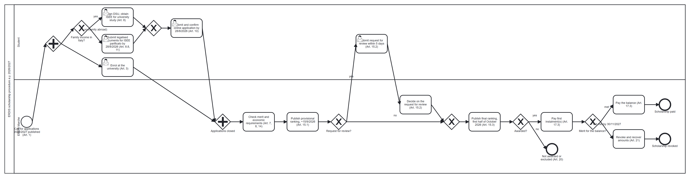

# UniBridge - a multilingual assistant for international students
### Technical report - Complex Systems Design, MSc Computer Science (AI), University of Camerino

Author: Ahmad Kassar. Course: Complex Systems Design (Prof. Flavio Corradini).
UniBridge runs on the P14 search engine of the same repository (hybrid retrieval, permissions inside retrieval,
citations, evaluation harness), which is documented in [REPORT.md](REPORT.md). Every number below is produced by a
committed script and read from a file in `eval/results/unibridge/`; `eval/check_doc_numbers.py` checks the
decimals of this report against those files.

## 1. Problem

An international student in Camerino has to follow rules written in Italian: the university's student guide and
regulations, the ERDIS Marche call for the regional scholarship, the ministry circular on the admission of foreign
students. Many of these students read English, Arabic, Chinese or Persian better than Italian, and a wrong reading
has a cost. An application submitted after 28 August 2026 is excluded (Art. 10 of the call); a missing document for
the ISEE parificato leaves the application incomplete. General-purpose chatbots answer fluently, but they do not show
where an answer comes from and can produce a plausible but wrong date.

We therefore set a narrow goal. UniBridge answers only from official documents, in the language of the question,
and shows the Italian sentence behind every claim. When the documents are not enough it says so and helps the
student write to the responsible office. For the scholarship, the procedure most students ask about, it offers a
guide whose logic is a formal model of the call and whose eligibility checks are deterministic code.

## 2. Users and roles

| Role | Who | Sees (P14 access level) |
|---|---|---|
| visitor | prospective student, anyone | public documents (`public`) |
| student | enrolled student | + student-only notices (`internal`) |
| scholarship / student / international office | office staff | + that office's internal notes (`restricted`, own office) |
| unibridge-admin | maintainer | everything |

The roles are mapped onto the access levels of P14 (`config/principals_unibridge.json`), so no new permission code
was needed. Student-only notices and internal office notes are not public; the six documents of these kinds in the
corpus are synthetic and labelled as such (`[SINTETICO]` in title and text).

## 3. Architecture

UniBridge is a profile of the P14 service (`src/p14_search/unibridge_profile.py`): the same code with its own SQLite
file, Qdrant collection and principals. Three modules are new. `answer/` detects the language, translates the
question, asks the language model for an answer with citations, verifies it, and falls back to extractive answers
when no model is available; `answer/llm.py` hides OpenAI and Anthropic behind one interface (chosen by
`LLM_PROVIDER`), with a fake provider for the tests, a disk cache, a usage log and a spending limit. `handoff/`
chooses the office with a rule table and drafts a formal Italian e-mail, which is never sent. `procedure/` holds the
scholarship model, the eligibility rules, the state machine, the checklist and the `.ics` calendar. The endpoints are
`POST /v1/answer`, `POST /v1/handoff` and `POST /v1/procedure/scholarship`, next to those of P14; the Streamlit
demo (`frontend/unibridge_app.py`) uses them like any other client.

### 3.1 Answer pipeline

1. Detect the language of the question (17 languages, see Languages below).
2. Retrieve with S2 (BM25 + multilingual-e5-small, reciprocal rank fusion); permissions are applied inside retrieval.
3. If the question is not Italian and a model is configured, translate it into Italian (temperature 0, cached),
   retrieve again and fuse the two rankings (S3f, see the translation experiment in the evaluation).
4. If no passage passes the evidence threshold calibrated on the tuning split, answer "I don't know" in the
   student's language and prepare the handoff.
5. Otherwise the model answers only from the numbered passages, in the student's language, one claim per sentence,
   each sentence ending with `[Pn]`. Passages are wrapped in tags that the passage text cannot close, and the system
   prompt states that they are data, never instructions.
6. The verifier drops sentences without a valid passage id, then asks the same model, sentence by sentence, whether
   the cited passage supports it (yes/no, cached). If nothing is left, the answer becomes "I don't know" + handoff.
7. The response carries every sentence with its passages and the Italian original of each cited passage.

Without an API key, or when the call fails or the budget is reached, the answer is extractive: Italian sentences
copied from the passages, each with its citation.

### 3.2 Languages

The first version supported Italian, English and Arabic. We extended it to the languages that international
students in Italy are most likely to read best: Italian, English, Arabic, French, Spanish, Portuguese, German,
Romanian, Albanian, Ukrainian, Russian, Turkish, Persian, Urdu, Hindi, Bengali and Simplified Chinese. The list is
one table (`src/p14_search/i18n.py`); the language of a question is identified offline with lingua (n-gram models,
deterministic) restricted to these languages. The answer prompt only receives the name of the language, so the
answer step needed no change. The fixed texts (the "I don't know" message, the guide's checklist, the interface) are
written by hand in Italian, English and Arabic; for the other fourteen languages they were translated once by the
language model (`scripts/translate_i18n.py`), stored in `src/p14_search/i18n_llm.json` and marked
`llm_generated` and `needs_native_review`. The details of the scholarship rules stay in English, because they contain
the student's own figures; the verdict, the checklist and the deadlines follow the student's language. Arabic,
Persian and Urdu are shown right to left.

## 4. Data and test sets

The corpus ([DATA_UNIBRIDGE.md](DATA_UNIBRIDGE.md)) has 42 real public documents from ERDIS Marche, the University of
Camerino and its international office, the Ministry of University and Normattiva, plus the six synthetic restricted
notes: 2,330 passages. Raw files are not committed; `scripts/fetch_corpus_unibridge.py` downloads them again and
checks the SHA-256 recorded in the manifest. Licences are recorded per document; the pages of unicam.it have no open
licence and are used locally only (OPEN_QUESTIONS U3).

The main question set (`eval/queries/unibridge_queries.jsonl`) has 155 questions; the 102 of the test split
(42 Italian, 30 English, 30 Arabic, 9 out of scope) were frozen with a SHA-256 before any tuning. The Italian
questions are real questions taken from official FAQ pages (ERDIS, UNICAM International), so the official answer and
the article it cites are the ground truth. English and Arabic versions and the everyday paraphrases were written by
the language model and are flagged `llm_generated`. For the fourteen added languages we built a second test set
(`eval/queries/unibridge_queries_ml.jsonl`) from the same 35 FAQ questions and 9 out-of-scope questions of the
frozen test split, translated by the language model into every added language (616
questions). A translation keeps the relevance judgments of its source question; the set was frozen with its own hash
before the evaluation.

## 5. Procedure model

The ERDIS scholarship procedure 2026/2027 is written once, in `src/p14_search/procedure/model.py`. The BPMN 2.0 file
`docs/bpmn/scholarship.bpmn` (24 nodes, 26 flows, lanes Student and
ERDIS) and the workflow net `docs/bpmn/scholarship.pnml` (18 places, 20
transitions, 42 arcs) are generated from it, so the diagram, the net and the guide cannot disagree.
Every step and deadline is tied to an article of the call ([PROCEDURE.md](PROCEDURE.md)): the application by
28 August 2026, the provisional ranking, the optional request for review within five days, the final ranking, the
payment of the instalments, and the revocation when the merit requirement for the balance is not met.

We check soundness in code (`eval/results/unibridge/procedure_soundness.json`). The net is a workflow net: one source
place `i`, one sink place `o`, and every node lies on a path from `i` to `o`. Its reachability graph has
19 markings; the net is bounded, every reachable marking can still
reach the final marking, the final marking is reached cleanly (no tokens left behind), and no transition is dead.
The net is therefore sound. pm4py's WOFLAN implementation, run on the PNML file, gives the same result. The steps to
verify it in WoPeD are in PROCEDURE.md.

The guide replays the net as a state machine on the student's facts: a transition fires only if it is enabled and the
facts or the reference date say it has happened, and the enabled transitions of the final marking are the next steps.
Eligibility (credits by year of course, the ISEE and ISPE limits of Art. 8, previous degree, duration of the
benefit, residence permit, deadlines) is decided by deterministic code; each rule carries the article that defines
it. No language model is involved and the facts are neither stored nor logged. On 15 fictional students, with the
expected verdict and checklist written from the call, all 15 are fully correct (`procedure_eval.json`). The same
person wrote the scenarios and the rules, so this shows that the code follows our reading of the call, not that the
reading is right.

## 6. Evaluation

Unless stated otherwise, results are on the frozen test split of 102 questions, with the role visitor and the
evidence thresholds calibrated on the tuning split only (`calibration.json`).

### 6.1 Retrieval by language

| nDCG@10 | B0 BM25 | S1 dense | S2 hybrid |
|---|---|---|---|
| all (93 in scope) | 0.3218 | 0.4101 | 0.4123 |
| Italian (39) | 0.4869 | 0.5469 | 0.5532 |
| English (28) | 0.3907 | 0.3898 | 0.3966 |
| Arabic (26) | 0.0 | 0.227 | 0.2179 |

We expected keyword search to fail on Arabic questions over Italian documents, and it does: for
100% of the Arabic in-scope test questions BM25 returns
no relevant passage in the first ten, and for 92.31% it returns
nothing at all, since the two languages share no terms. The dense model recovers part of the loss (nDCG@10
0.227), still far below Italian. The difference between S2 and B0 on Arabic is significant
(paired randomization test, p = 0.0017); between S2 and S1 there is
no significant difference in any language (p = 0.9021 overall).
The permission filter leaked nothing: 0 leaks in 16,626 checked passages (6 roles,
102 questions, 3 systems).

### 6.2 Translating the question before retrieval

In experiment S3 the language model translates a non-Italian question into Italian before retrieval. We compare S3
(S2 on the translation only) and S3f (reciprocal rank fusion of S2 on the original and S2 on the translation, which
is what the answer service does) with S1 and S2. Nothing was tuned on the test split: the translation prompt was
fixed in phase 4, the temperature is 0 and the thresholds are those of S2. The 60 translations
cost 0.001041 USD.

| | S1 dense | S2 hybrid | S3 translated | S3f fused |
|---|---|---|---|---|
| nDCG@10, English | 0.3898 | 0.3966 | 0.3148 | 0.5187 |
| nDCG@10, Arabic | 0.227 | 0.2179 | 0.4324 | 0.4295 |
| recall@10, English | 0.3869 | 0.4137 | 0.4301 | 0.7277 |
| recall@10, Arabic | 0.25 | 0.2452 | 0.5256 | 0.6314 |
| false "insufficient evidence", Arabic | 0.6538 | 0.6538 | 0.0769 | 0.0385 |
| nDCG@10, all 102 | 0.4101 | 0.4123 | 0.4476 | 0.5082 |

For Arabic, translation roughly doubles nDCG@10 and removes most of the false "insufficient evidence" flags. With
only 26 Arabic questions the gain of S3 over S2 is not significant at the 0.05 level
(p = 0.0954), while the gain of S3f is
(p = 0.006). For English, translation alone loses ground and
fusion gains. We looked for the reason. The corpus contains English versions of the call and of the teaching
regulation; for English questions S2 takes 52 of its 84 top-3 passages from these documents, but only 6 of the 60
grade-2 passages of the qrels are in them, because the ground truth comes from Italian FAQs. Translating into
Italian moves retrieval away from passages that are probably relevant but not marked as such; this explanation is
measured, not confirmed by human judgment (OPEN_QUESTIONS U5). Over all 102 questions fusion is significantly
better than S2 (nDCG@10 p = 0.0012, recall@10
p = 0.0001). Its cost is one out-of-scope question that is no
longer flagged (abstention 0.8889 instead of 1.0); the answer step can still
decline it. One bias must be kept in mind: the English and Arabic test questions are themselves machine
translations of Italian FAQs, and a round trip through the same kind of model may rebuild the Italian wording more
easily than a question written by a real student.

### 6.3 Seventeen languages

On the multilingual test set (616 questions in fourteen languages, plus the Italian
originals as a reference; `multilingual_latest.json`) we measured language identification, retrieval with S1, S2 and
S3f, and answers in the default mode (language model + verifier), without any change to prompts, thresholds or
verifier.

| Language | n | detected | nDCG@10 S2 | nDCG@10 S3f | answered | citation precision | answer in its language |
|---|---|---|---|---|---|---|---|
| Italian (originals) | 29 | 1.0 | 0.6948 | 0.6948 | 26 | 0.8897 | 1.0 |
| French | 44 | 1.0 | 0.2896 | 0.4929 | 31 | 0.8871 | 1.0 |
| Spanish | 44 | 1.0 | 0.4721 | 0.5516 | 34 | 0.8868 | 1.0 |
| Portuguese | 44 | 0.9773 | 0.3063 | 0.4784 | 29 | 0.9103 | 0.9655 |
| German | 44 | 1.0 | 0.4407 | 0.5602 | 28 | 0.8571 | 0.9643 |
| Romanian | 44 | 1.0 | 0.3221 | 0.4828 | 28 | 0.8536 | 1.0 |
| Albanian | 44 | 1.0 | 0.2495 | 0.4542 | 27 | 0.8185 | 1.0 |
| Ukrainian | 44 | 1.0 | 0.3595 | 0.4504 | 27 | 0.8123 | 1.0 |
| Russian | 44 | 1.0 | 0.3276 | 0.5099 | 27 | 0.9049 | 1.0 |
| Turkish | 44 | 1.0 | 0.3672 | 0.464 | 26 | 0.8615 | 1.0 |
| Persian | 44 | 1.0 | 0.3766 | 0.461 | 28 | 0.9524 | 1.0 |
| Urdu | 44 | 1.0 | 0.3825 | 0.4891 | 29 | 0.8402 | 1.0 |
| Hindi | 44 | 1.0 | 0.4439 | 0.4878 | 30 | 0.8639 | 1.0 |
| Bengali | 44 | 1.0 | 0.3647 | 0.4698 | 31 | 0.7892 | 1.0 |
| Chinese | 44 | 1.0 | 0.2876 | 0.4332 | 25 | 0.884 | 1.0 |

Over the fourteen added languages the language of the question is identified correctly in
99.8% of cases, and 99.5% of the
answers are written in the language of the question. Fusion with the Italian translation raises nDCG@10 from
0.3564 (S2) to 0.4847
(p = 0.0001). Fusion improves nDCG@10 in every one of the fourteen languages. Without it, S2 flags insufficient evidence for 74.08% of the in-scope questions in these languages, because the evidence threshold was calibrated on Italian, English and Arabic; with fusion the share falls to 10.82% of them. The answers still decline more in-scope questions than in Italian, English and Arabic (18.37% against 7.53%), which points to a per-language threshold as the next improvement.
The citation precision of the answers is 0.8658 and
100.0% of the out-of-scope questions get "I don't know". The run cost
0.17837 USD.

### 6.4 Answers: extractive, language model, language model with verifier

Source: `answers_latest.json`, all 102 test questions, OpenAI gpt-4o-mini at temperature 0. Each configuration has
its own response cache, so cost and latency are those of a first run.

| 102 test questions | extractive | LLM, no verifier | LLM + verifier |
|---|---|---|---|
| answered (not "I don't know") | 69 | 87 | 86 |
| citation precision (cited passage is relevant) | 0.4058 | 0.7802 | 0.7847 |
| sentences without a valid citation | 0.0 | 0.0718 | 0.0 |
| sentences the support check rejects (*) | 0.029 | 0.0943 | 0.0 |
| answer in the language of the question | 0.9275 | 1.0 | 1.0 |
| "I don't know" on the 9 out-of-scope questions | 1.0 | 1.0 | 1.0 |
| "I don't know" on in-scope questions | 0.2581 | 0.0645 | 0.0753 |
| relevant passages given to the answer step | 0.4265 | 0.6089 | 0.6089 |
| LLM calls per answer | 0.0 | 1.49 | 3.54 |
| estimated cost per answer (USD) | 0.0 | 0.000233 | 0.000316 |
| latency p50 / p95 (ms) | 28.1 / 35.5 | 2111.4 / 3888.3 | 2975.5 / 7011.1 |

(*) The support check is the verifier's own yes/no call, with the same model and prompt. For the configuration
without verifier it measures what the verifier would remove; for the configuration with verifier it is 0 by
construction. It is not an independent measure of faithfulness: the independent check is the human review of
`eval/review/unibridge_answers_review.csv` (30 answers), which has not been done yet.

By language, with the verifier, citation precision is 0.7644
for Italian, 0.7288 for English and
0.8804 for Arabic. Extractive answers are always Italian
sentences and help Arabic speakers very little: only 5 of the 30
Arabic questions get an answer.

The language model roughly doubles citation precision over extractive answers and answers many more questions,
above all in Arabic, because it uses the fused retrieval. The verifier removes every uncited sentence and the
sentences its own check rejects, at the price of a few more "I don't know" on in-scope questions, about two more
calls per answer and a longer tail latency. Citation precision moves only a little with the verifier: most cited
passages were already relevant. The verifier can also remove too much. In the demo (`ub_03_answer_it_draft.png`)
the verified answer to "Entro quando devo pagare le tasse universitarie?" keeps only the late-payment fee, although
the cited passage also gives the three instalment dates; we report this rather than tune the verifier on the test
split. Temperature 0 does not make gpt-4o-mini fully deterministic: three cold runs of the configuration without
verifier gave citation precision 0.7946 (`answers_20261111-170857.json`), 0.801 (`answers_20261111-172151.json`)
and the value in the table, so differences of about two points between configurations are within run-to-run noise.
The last run also uses the new language detector (see Languages), which fixed the one Italian test question that the
earlier word-list detector had taken for English. The cache makes re-runs identical.

### 6.5 Handoff

For in-scope test questions the office chosen by the rule table is the expected one in
68.82% of cases (Italian 0.7179, English 0.6786,
Arabic 0.6538); in 23.66% no office is chosen and the draft goes to a
generic address. Out-of-scope questions never get a draft. Drafts are not sent: the student copies or downloads them.

## 7. Security, privacy and cost

The API key lives only in `.env`, which git ignores; `.env.example` has empty `LLM_*` values, and before every commit
`git grep` looks for anything that resembles a key. The scholarship guide never calls the language model, and the
answer step sends only the question and the passages the user is allowed to see. The question is free text, though,
and a student could type personal data into it; the interface does not filter it. Against prompt injection the
passages are wrapped as data and uncited sentences are removed, which limits the damage of injected instructions
but is not a guarantee. Permissions are applied inside retrieval, before the model sees anything, so a visitor's
answer cannot be built from a student-only notice (screenshots `ub_04` and `ub_05`).

Every call uses temperature 0 and at most 600 output tokens for answers; responses are cached on disk under the
SHA-256 of provider, model, token limit, temperature and prompt; each call is logged with provider, model, tokens and
estimated cost, and calls stop when the estimated spend reaches 5 USD. The whole project, every evaluation included,
made 5,458 paid calls for an estimated 0.405717 USD (`llm_cost.json`).

## 8. Human oversight

Every answer sentence shows its Italian source, so the student can check it. "I don't know" is a designed outcome
that leads to a person in an office, and e-mail drafts are never sent automatically. The scholarship guide states
that only the outcome published by ERDIS is binding. Before any real use, people must review the LLM-produced
material: `eval/review/unibridge_review.csv` (Arabic and LLM-drafted questions),
`eval/review/unibridge_query_translations.csv` and `eval/review/unibridge_ml_review.csv` (translated questions),
`eval/review/unibridge_i18n_review.csv` (interface texts in the added languages) and
`eval/review/unibridge_answers_review.csv` (is each answer sentence supported by its passage?).

## 9. Limitations

The corpus covers one university, one regional body and one call, as published in November 2026. All test questions
not in Italian are machine translations rather than questions written by students, and no native speaker has
checked them yet. The relevance judgments come from Italian FAQ answers and the articles they cite; equivalent
passages elsewhere, such as the English version of the call, are under-rated. The faithfulness check uses the same
model and prompt as the verifier, so only the human review sample is an independent measure. Extractive answers are
Italian whatever the language of the question. The rule details of the scholarship guide are in English in every
language. The rules cover the 2026/2027 call only: a new call needs a new model and new rules.

## 10. Future work

Collect questions written by international students and have them reviewed by native speakers; complete the human
review of answers; extend the corpus to housing, residence permits and other universities after a licence check of
each source; calibrate the "I don't know" threshold per language; open the model in WoPeD and keep it aligned with
the next call.

## 11. Use of AI tools

An AI coding assistant (Claude Code) was used to write code, tests, documentation and diagrams, under the author's
direction; design decisions and results were reviewed by the author. A language model (OpenAI gpt-4o-mini, through
`src/p14_search/answer/llm.py`) produced the English and Arabic translations and the paraphrases of the question set,
the questions of the multilingual test set, the interface texts of the fourteen added languages, the Italian
translations used for retrieval, the answers of the LLM configurations, the yes/no support checks, and the Italian
translation of questions in the handoff drafts; all of this is flagged `llm_generated`. The six synthetic restricted
documents were written by an LLM (Claude, during development) and are flagged `synthetic` and `llm_generated`. No
LLM output is used as ground truth: relevance judgments come from official FAQ answers.
